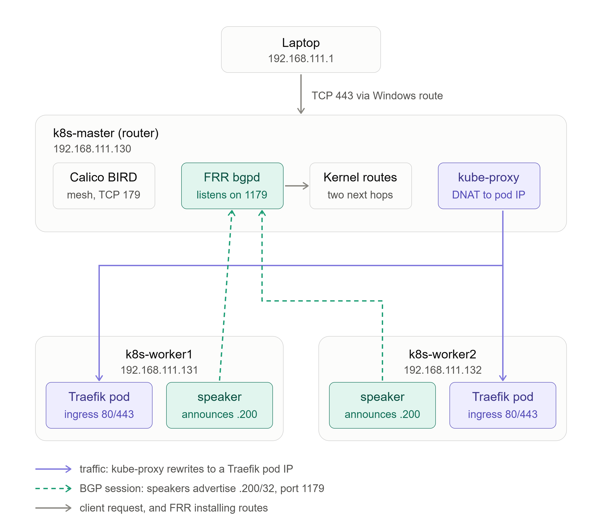
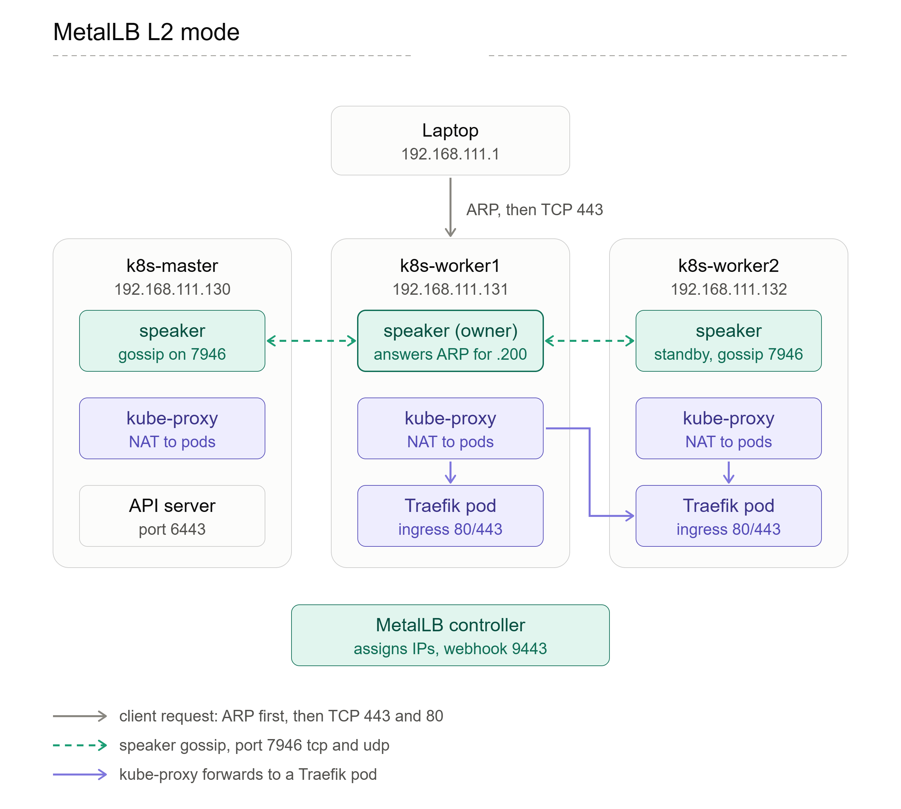

# Kubernetes Cluster Setup Guide

Setup a K8s cluster from scratch with 3 Nodes (1 Master and 2 Worker) using `kubeadm`.

### VM Configuration
*   **vCPU:** 2
*   **Memory:** 4 GB
*   **Diskspace:** 40 GB
*   **OS:** RHEL 10
*   **Master NodeIP:** 192.168.111.130
*   **Worker NodeIP:** 192.168.111.131 and 192.168.111.132
*   **Load Balancer IP_Range:** 192.168.111.200-192.168.111.220

### Post-Setup Addons & Operators
After the initial setup, the following addons and operators are installed and configured for their respective purposes:

*   **Container Network Interface (CNI):** Calico
*   **Load Balancer:** MetalLB (Configured in BGP Mode instead of the default L2 Mode)
*   **Ingress Controller:** Traefik
*   **Container Storage Interface (CSI):** Longhorn
*   **Observability:** Metrics Server, Prometheus, and Grafana
*   **K8s Dashboard:** Headlamp
*   **CI/CD:** ArgoCD
*   **Secrets Manager:** *[Pending / To be added]*
*   **Cert Manager:** *[Pending / To be added]*
*   **Security:** RBAC, NetworkPolicies, Encryption@Rest, Audit Logging, Pod Security, etc.
*   **Workload Hygiene:** Resource requests/limits, liveness/readiness probes, Pod Disruption Budgets, Autoscaling, Node Selector/Affinity, etc.

---

### Installing k8's
1. Set Hostnames & Map IPs
```bash
#Master Node
sudo hostnamectl set-hostname k8s-master

#Worker Node1
sudo hostnamectl set-hostname k8s-worker1

#Worker Node2
sudo hostnamectl set-hostname k8s-worker2       
```
Map the static IPs of nodes inside /etc/hosts on all Nodes (Master and Both Workers)
```bash
sudo tee -a /etc/hosts <<EOF
192.168.111.130 k8s-master
192.168.111.131 k8s-worker1
192.168.111.132 k8s-worker2
EOF
```

2. Disable Swap & Configure SELinux
Kubernetes requires swap memory to be disabled entirely for proper performance scheduling
```bash
#Disable swap instantly
sudo swapoff -a

#Persist the change across reboots
sudo sed -i '/ swap / s/^\(.*\)$/#\1/g' /etc/fstab

#SELinux in permissive mode
sudo setenforce 0
sudo sed -i 's/^SELINUX=enforcing$/SELINUX=permissive/' /etc/config/selinux
sudo sed -i 's/^SELINUX=enforcing$/SELINUX=permissive/' /etc/selinux/config

#Should print permissive
getenforce
```

3. Enable Kernel Modules and Sysctl Networking Bridge
Allow Linux bridging tables to inspect cluster pod traffic
```bash
sudo tee /etc/modules-load.d/k8s.conf <<EOF
overlay
br_netfilter
EOF

sudo modprobe overlay
sudo modprobe br_netfilter

# Configure sysctl parameters
sudo tee /etc/sysctl.d/k8s.conf <<EOF
net.bridge.bridge-nf-call-iptables  = 1
net.bridge.bridge-nf-call-ip6tables = 1
net.ipv4.ip_forward                 = 1
EOF

# Apply system changes without restarting
sudo sysctl --system
```

4. Configure Firewalld Ports
If firewalld is active, expose the mandatory system networking hooks
```bash
#On Master Node
sudo firewall-cmd --permanent --add-port={6443,2379-2380,10250,10251,10252}/tcp
sudo firewall-cmd --reload

#On Worker Nodes
sudo firewall-cmd --permanent --add-port={10250,30000-32767}/tcp
sudo firewall-cmd --reload

#For Calico (CNI) on All Nodes
sudo firewall-cmd --permanent --add-port=179/tcp --add-port=5473/tcp --add-port=4789/udp
sudo firewall-cmd --reload
```

5. Install containerd on All Nodes
```bash
# Provide Docker CE repo to pull containerd package binary
sudo rm -f /etc/yum.repos.d/docker*.repo
sudo dnf config-manager --add-repo https://download.docker.com/linux/rhel/docker-ce.repo
sudo dnf clean all

# Install containerd package
sudo dnf install -y containerd.io

# Generate default configuration directory layout
sudo mkdir -p /etc/containerd
containerd config default | sudo tee /etc/containerd/config.toml > /dev/null

# Critical: Configure containerd to utilize Systemd Cgroup driver
sudo sed -i 's/SystemdCgroup = false/SystemdCgroup = true/g' /etc/containerd/config.toml

# Start and persist containerd service engine
sudo systemctl restart containerd
sudo systemctl enable containerd
```

6. Install Kubernetes Tools All Node: kubeadm, kubelet, kubectl
```bash
sudo tee /etc/yum.repos.d/kubernetes.repo <<EOF
[kubernetes]
name=Kubernetes
baseurl=https://pkgs.k8s.io/core:/stable:/v1.34/rpm/
enabled=1
gpgcheck=1
gpgkey=https://pkgs.k8s.io/core:/stable:/v1.34/rpm/repodata/repomd.xml.key
EOF

# Synchronize repo and install packages
sudo dnf install -y kubelet kubeadm kubectl --disableexcludes=kubernetes

# Enable the orchestration agent on engine boot
sudo systemctl enable --now kubelet
```

7.Initialize Cluster: Bootstrap the Control Plane
```bash
systemctl enable kubelet.service
sudo kubeadm init --apiserver-advertise-address=192.168.111.130 --pod-network-cidr=10.244.0.0/16
kubectl get nodes
```
<pre>
Your Kubernetes control-plane has initialized successfully!
To start using your cluster, you need to run the following as a regular user:
    mkdir -p \$HOME/.kube
    sudo cp -i /etc/kubernetes/admin.conf \$HOME/.kube/config
    sudo chown \$(id -u):(id -g) HOME/.kube/config

Nodes show NotReady until the CNI is installed.
    [root@localhost ~]# kubectl get nodes
    NAME         STATUS     ROLES           AGE     VERSION
    k8s-master   NotReady   control-plane   9m12s   v1.30.14
</pre>

---

### Installing Calico (CNI)
1. Deploy a pod network to the cluster.
```bash
kubectl create -f https://raw.githubusercontent.com/projectcalico/calico/v3.33.0/manifests/tigera-operator.yaml
kubectl get crd | grep -i projectcalico
curl -O https://raw.githubusercontent.com/projectcalico/calico/v3.33.0/manifests/custom-resources.yaml

#Update the pod cidr value in custom-resources.yaml to (10.244.0.0/16)
vi custom-resources.yaml
```
```bash
kubectl create -f custom-resources.yaml

#Wait till the pods are in running state
kubectl get pods -n calico-system -w
```
```bash
#Check the Calico CRD
kubectl get crd | grep -c projectcalico.org

#Optional: Incase of any configurational changes, perform rollout to reflect the change.
kubectl rollout restart deploy/tigera-operator -n tigera-operator

#Create Token to add nodes to k8s cluster
kubeadm token create --print-join-command

#Then join Worker Nodes by executing the join command (generated by above command) on each Worker Node as root
```
```bash
kubectl get nodes
```
<pre>
Your Kubernetes control-plane has initialized successfully!
To start using your cluster, you need to run the following as a regular user:
    mkdir -p $HOME/.kube
    sudo cp -i /etc/kubernetes/admin.conf $HOME/.kube/config
    sudo chown $(id -u):$(id -g) $HOME/.kube/config
</pre>

---

### Installing Git and Helm
```bash
sudo dnf install -y git
curl -fsSL https://raw.githubusercontent.com/helm/helm/main/scripts/get-helm-3 | bash
helm version
```

---

### Installing Load Balancer (MetalLB)
<pre>
We chose BGP Mode instead of the default L2 Mode, to learn and to get real load balancing at the entry point.

Default mode: L2
One node answers ARP for the LoadBalancer IP, and all incoming traffic enters through that node. kube-proxy then forwards it to a pod, possibly on another node. No router needed, and it works on any flat network.
Limits: one node’s network card carries all entry traffic, and failover takes a few seconds while another node takes over the ARP answer.

BGP Mode:
Each Worker Node tells a router “send 192.168.111.200 to me”, and the router spreads traffic across all of them (ECMP). The load is balanced across Worker Nodes at the network level, there’s no single entry node, and a dead node’s route is withdrawn.
The costs:
It needs a router, which here is FRR on the Master Node.
It conflicts with Calico on port 179, so FRR configured to runs on 1179.
Clients need a route through the Master Node.
The Master Node becomes a single point of failure.
Asymmetric return paths can cause trouble on a single subnet.

FRR (Free Range Routing): Is open-source routing software for Linux. It turns an ordinary Linux machine into a router that speaks the same protocols as network gear from Cisco or Juniper.
The Master Node runs FRR as the router (ASN 64512, port 1179).
The MetalLB speakers on the Worker Node connect to it over BGP and say “I can deliver 192.168.111.200”. FRR puts those routes in the master’s kernel table, with maximum-paths 4 allowing it to use both workers at once (ECMP).
</pre>

MetalLB BGP mode



MetalLB L2 mode



```bash
#Check the port 179 situation first, on the Master and Worker Nodes.
#Since calico uses port 179 by default, the BGP router configured to use 1179 
sudo ss -ltnp | grep ':179 '

#Install and configure FRR on Master Node
sudo dnf install -y frr

#Edit /etc/frr/daemons and update the values as below
bgpd=yes
bgpd_options="   -A 127.0.0.1 -p 1179"

vi /etc/frr/daemons

#Edit /etc/frr/frr.conf and update the values as below
frr defaults traditional
hostname k8s-master
log syslog informational
!
router bgp 64512
 bgp router-id 192.168.111.130
 no bgp ebgp-requires-policy
 neighbor 192.168.111.131 remote-as 64513
 neighbor 192.168.111.131 passive
 neighbor 192.168.111.132 remote-as 64513
 neighbor 192.168.111.132 passive
 !
 address-family ipv4 unicast
  maximum-paths 4
 exit-address-family
!

vi /etc/frr/frr.conf
#"passive" makes FRR wait for the workers to connect instead of dialing out, which would hit Calico’s BIRD on port 179

cat <<EOF | sudo tee /etc/sysctl.d/90-router.conf
net.ipv4.ip_forward = 1
net.ipv4.conf.all.send_redirects = 0
EOF

sudo sysctl --system
sudo firewall-cmd --permanent --add-port=1179/tcp && sudo firewall-cmd --reload
sudo systemctl enable --now frr
sudo ss -ltnp | grep 1179
```
```bash
#Firewall: All Nodes (Master, Worker1, Worker2), trust the node network and the pod network
sudo firewall-cmd --permanent --zone=trusted --add-source=192.168.111.0/24
sudo firewall-cmd --permanent --zone=trusted --add-source=10.244.0.0/16

#Calico: BGP between nodes, VXLAN, Typha
sudo firewall-cmd --permanent --add-port=179/tcp
sudo firewall-cmd --permanent --add-port=4789/udp
sudo firewall-cmd --permanent --add-port=5473/tcp

#kubelet, and MetalLB speaker membership
sudo firewall-cmd --permanent --add-port=10250/tcp
sudo firewall-cmd --permanent --add-port=7946/tcp --add-port=7946/udp

#Master Node
sudo firewall-cmd --permanent --add-port=6443/tcp
sudo firewall-cmd --permanent --add-port=2379-2380/tcp
sudo firewall-cmd --permanent --add-port=10257/tcp --add-port=10259/tcp
sudo firewall-cmd --permanent --add-port=1179/tcp

#Worker Nodes
sudo firewall-cmd --permanent --add-port=10256/tcp
sudo firewall-cmd --permanent --add-port=30000-32767/tcp
sudo firewall-cmd --permanent --add-port=30000-32767/udp

#Apply and Verify
sudo firewall-cmd --reload
sudo firewall-cmd --list-all
sudo firewall-cmd --zone=trusted --list-sources
```

```bash
#Install MetalLB (Master Node):
helm repo add metallb https://metallb.github.io/metallb
helm repo update
helm uninstall metallb -n metallb-system
helm install metallb metallb/metallb -n metallb-system --create-namespace --set frrk8s.enabled=false --set speaker.frr.enabled=false
	  
kubectl get pods -n metallb-system -w
	
#To see whether a pull is moving, check the Node(Master) the controller is on:
sudo ctr -n k8s.io images ls | grep metallb

#Or pull manually on that Node (Master) and watch the progress:
sudo ctr -n k8s.io images pull quay.io/metallb/controller:v0.16.1

kubectl get secret metallb-memberlist -n metallb-system

#Once the controller and speakers are Running, wait about 30 seconds, then create the pool:
sudo tee ~/metallb_pool.yaml <<EOF
apiVersion: metallb.io/v1beta1
  kind: IPAddressPool
  metadata:
    name: lab-pool
    namespace: metallb-system
  spec:
    addresses:
    - 192.168.111.200-192.168.111.220
EOF

kubectl -f apply metallb_pool.yaml
kubectl get ipaddresspool -n metallb-system

#Create the peer and advertisement
sudo tee ~/metallb_advertisement.yaml <<EOF
apiVersion: metallb.io/v1beta2
kind: BGPPeer
metadata:
  name: master-router
  namespace: metallb-system
spec:
  myASN: 64513
  peerASN: 64512
  peerAddress: 192.168.111.130
  peerPort: 1179
  nodeSelectors:
  - matchExpressions:
    - key: node-role.kubernetes.io/control-plane
      operator: DoesNotExist
---
apiVersion: metallb.io/v1beta1
kind: BGPAdvertisement
metadata:
  name: lab-bgp
  namespace: metallb-system
spec:
  ipAddressPools:
  - lab-pool
EOF

kubectl apply -f metallb_advertisement.yaml

#Check the sessions
sudo vtysh -c "show ip bgp summary"
```

---

### Installing Ingress Controller (Traefik)
```bash
helm repo add traefik https://traefik.github.io/charts
helm repo update
helm install traefik traefik/traefik -n traefik --create-namespace \
  --set deployment.replicas=2 \
  --set service.type=LoadBalancer \
  --set service.spec.externalTrafficPolicy=Local \
  --set-string service.annotations."metallb\.io/loadBalancerIPs"=192.168.111.200

kubectl get svc,pods -n traefik -o wide

#PfxRcd should go to 1 per neighbor
sudo vtysh -c "show ip bgp summary"

#two next hops: .131 and .132
sudo vtysh -c "show ip route 192.168.111.200"

#Access LB; expected http response 404
curl -i http://192.168.111.200

kubectl logs -n metallb-system metallb-speaker-bj9k5 | grep -i announc
```

---

### Installing Longhorn (CSI)
<pre>
Check disks and compatibility (workers): Longhorn stores data in /var/lib/longhorn by default. 
For a lab the root disk is fine if it has 30 GB or more free.
</pre>
```bash
lsblk
df -h /var/lib
```
```bash
#Prerequisites on both Worker Nodes
sudo dnf install -y iscsi-initiator-utils nfs-utils cryptsetup device-mapper
sudo systemctl enable --now iscsid
echo iscsi_tcp | sudo tee /etc/modules-load.d/iscsi_tcp.conf
sudo modprobe iscsi_tcp

#If multipathd is active, it can grab Longhorn’s block devices. Add a blacklist for sd[a-z0-9]+ devices to /etc/multipath.conf and restart it, or disable it if you don’t use multipath.
systemctl is-active multipathd
```
```bash
#Install Longhorn
helm repo add longhorn https://charts.longhorn.io
helm repo update
helm show values longhorn/longhorn | grep -inE 'replicaCount|ReplicaCount'
helm install longhorn longhorn/longhorn -n longhorn-system --create-namespace --set persistence.defaultClassReplicaCount=2 --set defaultSettings.defaultReplicaCount=2
kubectl get pods -n longhorn-system -o wide -w

#Verify
kubectl get sc
kubectl get nodes.longhorn.io -n longhorn-system

#PortForward to Access the Longhorn Console
#http://192.168.111.130/longhorn
#kubectl -n longhorn-system port-forward svc/longhorn-frontend 8080:80
kubectl -n longhorn-system port-forward --address 0.0.0.0 svc/longhorn-frontend 8080:8080

#Test creating pod, pv, pvc
sudo tee ~/longhorn_verify.yaml <<EOF
apiVersion: v1
kind: PersistentVolumeClaim
metadata:
  name: test-pvc
spec:
  accessModes: [ReadWriteOnce]
  storageClassName: longhorn
  resources:
    requests:
      storage: 1Gi
---
apiVersion: v1
kind: Pod
metadata:
  name: test-pod
spec:
  containers:
  - name: c
    image: busybox
    command: ["sh","-c","echo hello > /data/f && sleep 3600"]
    volumeMounts:
    - {name: v, mountPath: /data}
  volumes:
  - name: v
    persistentVolumeClaim:
      claimName: test-pvc
EOF

kubectl apply -f longhorn_verify.yaml
kubectl get pv,pvc,pod
```
```bash
#Create Target to configure backups.
#Backups go to an external target, so for the lab, create NFS export on the Master Node (Outside the Worker Node disks where PV exist)
#Make sure there's enough free space (20 GB+ is comfortable)
df -h /srv
sudo dnf install -y nfs-utils
sudo mkdir -p /srv/longhorn-backup
echo '/srv/longhorn-backup 192.168.111.0/24(rw,sync,no_root_squash)' | sudo tee -a /etc/exports
sudo systemctl enable --now nfs-server
sudo exportfs -rav
#Should list the export for 192.168.111.0/24
sudo exportfs -v
```
```text
Access Longhorn Console UI (Settings > Backup Target > Default [Edit]), use something like:
Name: default
URL	nfs://192.168.111.130:/srv/longhorn-backup
Poll interval: default
Credential secret: leave empty for NFS
```
```bash
kubectl exec test-pod -- ls /data
kubectl exec test-pod -- cat /data/f
kubectl exec test-pod -- sh -c 'echo before-backup > /data/f2 && sync'

#From Longhorn Console UI, Go to Volume, Select the Volume and Create Backup
#Master Node: Validate backup created
ls -R /srv/longhorn-backup | head

kubectl delete -f longhorn_verify.yaml
#kubectl delete pod test-pod
#kubectl delete pvc test-pvc

#From Longhorn Console UI, Go to Backup, Select the created Backup and Restore
#Then, Go to Volume, Select the Volume, From Burger Menu Create PV/PVC

sudo tee ~/longhorn_verify_restore.yaml <<EOF
apiVersion: v1
kind: Pod
metadata:
  name: restore-pod
spec:
  containers:
  - name: c
    image: busybox
    command: ["sleep","3600"]
    volumeMounts:
    - {name: v, mountPath: /data}
  volumes:
  - name: v
    persistentVolumeClaim:
      claimName: restored-test
EOF

kubectl apply -f longhorn_verify_restore.yaml
kubectl exec restore-pod -- ls /data/f2
kubectl exec restore-pod -- cat /data/f2
```

---

### Installing Metric Server
```bash
kubectl apply -f https://github.com/kubernetes-sigs/metrics-server/releases/latest/download/components.yaml
kubectl patch deployment metrics-server -n kube-system --type='json' -p='[{"op": "add", "path": "/spec/template/spec/containers/0/args/-", "value": "--kubelet-insecure-tls"}]'

kubectl get pod -A | grep -i metric
```

---

### Installing TLS Certificate
```bash
mkdir -p ~/lab-certs && cd ~/lab-certs

openssl genrsa -out ca.key 4096
openssl req -x509 -new -nodes -key ca.key -sha256 -days 1825 -subj "/CN=lab-ca" -out ca.crt

openssl genrsa -out tls.key 2048
openssl req -new -key tls.key -subj "/CN=*.192.168.111.200.nip.io" -out tls.csr
cat > ext.cnf <<EOF
subjectAltName=DNS:*.192.168.111.200.nip.io
extendedKeyUsage=serverAuth
EOF
openssl x509 -req -in tls.csr -CA ca.crt -CAkey ca.key -CAcreateserial -out tls.crt -days 825 -sha256 -extfile ext.cnf
  
kubectl create secret tls lab-tls -n traefik --cert=tls.crt --key=tls.key

sudo tee ~/traefik_cert.yaml <<EOF
apiVersion: traefik.io/v1alpha1
kind: TLSStore
metadata:
  name: default
  namespace: traefik
spec:
  defaultCertificate:
    secretName: lab-tls
EOF

kubectl apply -f traefik_cert.yaml

#Updating Traefik to redirect http to https:
helm show values traefik/traefik | grep -n -B2 -A6 redirections
helm upgrade traefik traefik/traefik -n traefik --reuse-values --set ports.web.http.redirections.entryPoint.to=websecure --set ports.web.http.redirections.entryPoint.scheme=https
```

---

### Installing Grafana and Prometheus
```bash
sudo tee ~/traefik_prometheus.yaml <<EOF
apiVersion: traefik.io/v1alpha1
kind: Middleware
metadata:
  name: basic-auth
  namespace: monitoring
spec:
  basicAuth:
    secret: basic-auth-secret
EOF

sudo tee ~/grafana_prometheus_values.yaml <<EOF
grafana:
  persistence:
    enabled: true
    storageClassName: longhorn
    size: 2Gi
  ingress:
    enabled: true
    ingressClassName: traefik
    annotations:
      traefik.ingress.kubernetes.io/router.entrypoints: websecure
      traefik.ingress.kubernetes.io/router.tls: "true"
    hosts:
      - grafana.192.168.111.200.nip.io
prometheus:
  ingress:
    enabled: true
    ingressClassName: traefik
    annotations:
      traefik.ingress.kubernetes.io/router.entrypoints: websecure
      traefik.ingress.kubernetes.io/router.tls: "true"
      traefik.ingress.kubernetes.io/router.middlewares: monitoring-basic-auth@kubernetescrd
    hosts:
      - prometheus.192.168.111.200.nip.io
  prometheusSpec:
    retention: 7d
    storageSpec:
      volumeClaimTemplate:
        spec:
          storageClassName: longhorn
          accessModes: ["ReadWriteOnce"]
          resources:
            requests:
              storage: 2Gi
alertmanager:
  enabled: false
EOF

kubectl create namespace monitoring
#By default prometheus UI does not have password, configuring secret so that browser will prompt for login
kubectl create secret generic basic-auth-secret -n monitoring --from-literal=users="admin:$(openssl passwd -apr1 'admin123')"
kubectl apply -f traefik_prometheus.yaml

helm repo add prometheus-community https://prometheus-community.github.io/helm-charts
helm repo update
helm install monitoring prometheus-community/kube-prometheus-stack -n monitoring -f grafana_prometheus_values.yaml --set grafana.adminPassword='admin123'
kubectl get pods -n monitoring -w
```
<pre>
Get Grafana 'admin' user password by running:
kubectl --namespace monitoring get secrets monitoring-grafana -o jsonpath="{.data.admin-password}" | base64 -d ; echo

Get your grafana admin user password by running:
kubectl get secret --namespace monitoring -l app.kubernetes.io/component=admin-secret -o jsonpath="{.items[0].data.admin-password}" | base64 --decode ; echo

Access Grafana local instance:
export POD_NAME=$(kubectl --namespace monitoring get pod -l "app.kubernetes.io/name=grafana,app.kubernetes.io/instance=monitoring" -oname)
kubectl --namespace monitoring port-forward $POD_NAME 3000
</pre>

---

### Installing Longhorn Authentication
```bash
sudo tee ~/traefik_longhorn.yaml <<EOF
apiVersion: traefik.io/v1alpha1
kind: Middleware
metadata:
  name: basic-auth
  namespace: longhorn-system
spec:
  basicAuth:
    secret: basic-auth-secret
---
apiVersion: networking.k8s.io/v1
kind: Ingress
metadata:
  name: longhorn
  namespace: longhorn-system
  annotations:
    traefik.ingress.kubernetes.io/router.entrypoints: websecure
    traefik.ingress.kubernetes.io/router.tls: "true"
    traefik.ingress.kubernetes.io/router.middlewares: longhorn-system-basic-auth@kubernetescrd
spec:
  ingressClassName: traefik
  rules:
  - host: longhorn.192.168.111.200.nip.io
    http:
      paths:
      - path: /
        pathType: Prefix
        backend:
          service:
            name: longhorn-frontend
            port:
              number: 80
EOF

kubectl create secret generic basic-auth-secret -n longhorn-system --from-literal=users="admin:$(openssl passwd -apr1 'admin123')"
kubectl apply -f traefik_longhorn.yaml
kubectl get ingress,middleware -n longhorn-system

curl --cacert ~/lab-certs/ca.crt -I https://longhorn.192.168.111.200.nip.io
curl --cacert ~/lab-certs/ca.crt -I -u admin:admin123 https://longhorn.192.168.111.200.nip.io
```

---

### Installing K8s Dashboard (Headlamp)
```bash
helm repo add headlamp https://kubernetes-sigs.github.io/headlamp/
helm repo update
helm install headlamp headlamp/headlamp -n headlamp --create-namespace

kubectl get svc,pods -n headlamp

#Optional: Get the application URL by running these commands:
export POD_NAME=$(kubectl get pods --namespace headlamp -l "app.kubernetes.io/name=headlamp,app.kubernetes.io/instance=headlamp" -o jsonpath="{.items[0].metadata.name}")
export CONTAINER_PORT=$(kubectl get pod --namespace headlamp $POD_NAME -o jsonpath="{.spec.containers[0].ports[0].containerPort}")

kubectl create token headlamp --namespace headlamp
kubectl --namespace headlamp port-forward $POD_NAME 8080:$CONTAINER_PORT

#Configure Ingress
sudo tee ~/traefik_longhorn.yaml <<EOF
apiVersion: networking.k8s.io/v1
kind: Ingress
metadata:
  name: headlamp
  namespace: headlamp
  annotations:
    traefik.ingress.kubernetes.io/router.entrypoints: websecure
    traefik.ingress.kubernetes.io/router.tls: "true"
spec:
  ingressClassName: traefik
  rules:
  - host: console.192.168.111.200.nip.io
    http:
      paths:
      - path: /
        pathType: Prefix
        backend:
          service:
            name: headlamp
            port:
              number: 80
EOF

kubectl apply -f traefik_headlamp.yaml

#Create Token
kubectl create serviceaccount headlamp-admin -n headlamp
#kubectl create clusterrolebinding headlamp-admin --clusterrole=cluster-admin --serviceaccount=headlamp:headlamp-admin
kubectl get clusterrolebinding headlamp-admin -o yaml

kubectl create clusterrolebinding headlamp-admin-lab --clusterrole=cluster-admin --serviceaccount=headlamp:headlamp-admin
kubectl create token headlamp-admin -n headlamp --duration=24h
kubectl auth can-i '*' '*' --as=system:serviceaccount:headlamp:headlamp
kubectl auth can-i '*' '*' --as=system:serviceaccount:headlamp:headlamp-admin

kubectl get pods -n headlamp
kubectl get pods,svc -n traefik -o wide
kubectl get ingress -n headlamp
```

### Troubleshooting
Issues faced while performing the setup and their respective fixes are documented in [`issues_fixes.md`](issues_fixes.md).
